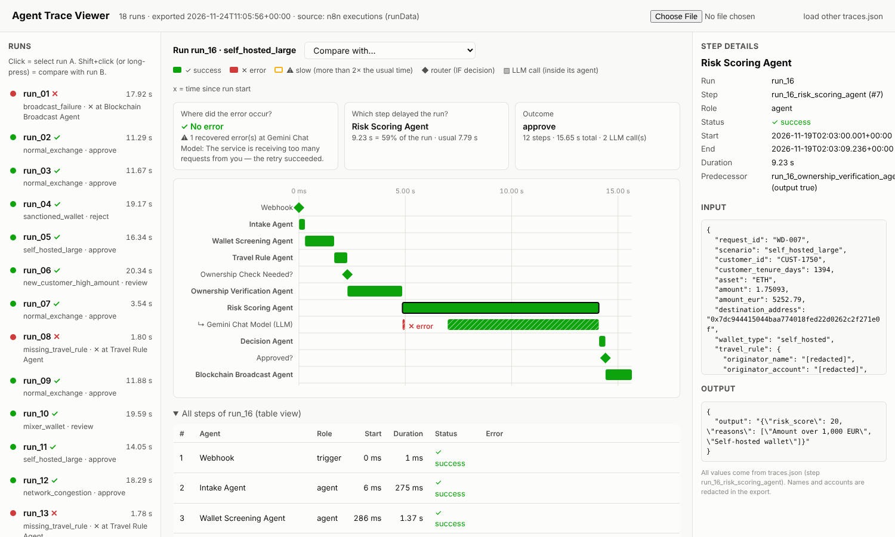
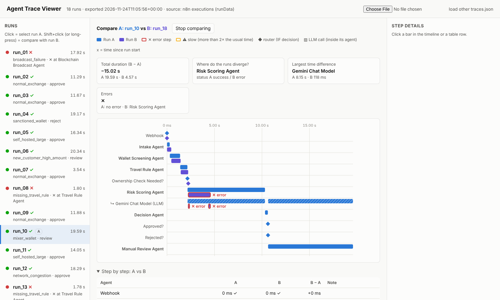
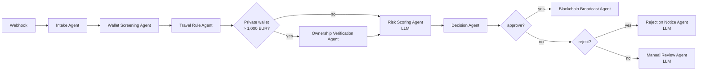

# llm-crypto-compliance-agent

**Multi-agent LLM workflow for crypto withdrawal checks, with a trace viewer to see what every agent did.**

A small, fully local project that shows **how a multi-agent LLM workflow behaves at run time**.
An n8n workflow with 9 agents (3 of them LLM-based, using Google Gemini) checks crypto withdrawals.
Every execution is exported as an anonymized trace, and a web viewer shows the runs as a timeline,
with step details and a side-by-side comparison of two runs.

All data is synthetic. No real customers, wallets or transactions.





Screenshots from real runs with Gemini (`gemini-3.5-flash-lite`). The rate-limit errors are real API responses, not simulated.

---

## What it shows

| Question | Where you see the answer |
|---|---|
| Which steps ran, in which order, and how long did each take? | Timeline: one row per agent, one bar per step, x = time since run start |
| Where did a run fail, and why? | Red bar with ✕ + error message; card "Where did the error occur?"; "⚠ retry" marks errors the run recovered from |
| Which step delayed the run? | Card "Which step delayed the run?"; steps that took more than 2× their usual time get a ⚠ outline |
| What did an agent get and return? What did the LLM answer? | Detail panel: input, output, model, token usage |
| How do two runs differ? | Compare mode: both runs on one time axis, first point where the paths diverge, largest time difference, step-by-step table |

---

## The scenario

A bank customer wants to send crypto (BTC, ETH, USDC) to an external wallet.
Before the money leaves, several agents check the request:



| Agent | Type | What it does | Can fail with |
|---|---|---|---|
| Intake | rules | Checks the 7 required fields | `missing field(s)` |
| Wallet Screening | rules | Compares the destination with a demo risk list (mixer, sanctioned) | – |
| Travel Rule | rules | Checks sender and receiver data (EU Travel Rule) | `Travel Rule data incomplete` |
| Ownership Verification | rules | Only for private wallets over 1,000 EUR; simulated signed-message check | – |
| Risk Scoring | **LLM** | Gemini rates the risk 0–100 and lists the reasons | API errors, rate limits |
| Decision | rules | Sanctioned → reject, score ≥ 50 → review, else approve | `LLM returned invalid JSON` |
| Blockchain Broadcast | rules | Simulated sending; slow when the network is congested | `Broadcast failed` |
| Rejection Notice | **LLM** | Writes a short, polite notice to the customer | API errors |
| Manual Review | **LLM** | Writes a case summary for a compliance analyst | API errors |

**Design choice:** hard compliance rules (sanctions, Travel Rule, final decision) stay deterministic code.
The LLM only proposes a risk score and writes text. The Decision Agent applies the final rules.

### Test scenarios

`scripts/generate_requests.py` creates 18 requests with fixed scenarios, so every path through the workflow is covered:

| Scenario | Count | Expected result |
|---|---|---|
| normal_exchange | 6 | approve |
| self_hosted_large | 3 | extra ownership step, approve |
| mixer_wallet | 2 | manual review |
| sanctioned_wallet | 1 | reject |
| new_customer_high_amount | 1 | manual review |
| network_congestion | 1 | slow broadcast, approve |
| missing_field | 1 | error at Intake |
| missing_travel_rule | 2 | error at Travel Rule |
| broadcast_failure | 1 | error at Broadcast |

---

## Quick start

Requirements: Docker Desktop, Python 3, a free Google AI Studio API key.

```bash
cp .env.example .env
docker compose up -d --build
```

- n8n: http://localhost:5678 (create the local owner account on first start)
- Trace viewer: http://localhost:8080

### 1. Import the workflow

```bash
docker compose exec n8n n8n import:workflow --input=/workflows/crypto_withdrawal_workflow.json
```

### 2. Connect the LLM

1. Create a key at https://aistudio.google.com/apikey
2. n8n → Overview → Credentials → Create credential → **Google Gemini (PaLM) Api** → paste the key → Save
3. Open the workflow, double-click **Gemini Chat Model**, select the credential and a model that is available for your key
   (tested with `gemini-3.5-flash-lite`; older models such as `gemini-2.5-flash` are no longer offered to new keys)
4. Click **Publish**. Changes only become active after publishing.

The key stays inside n8n. It is never part of the workflow file or the trace export.

### 3. Create runs and export traces

```bash
python3 scripts/generate_requests.py      # optional: new synthetic requests
python3 scripts/send_requests.py          # one workflow run per request
```

Create an n8n API key (http://localhost:5678/settings/api, scopes `execution:list`, `execution:read`), then:

```bash
export N8N_API_KEY="..."
export N8N_WORKFLOW_ID="..."              # optional: the ID from the workflow URL
python3 scripts/export_traces.py          # writes traces/traces.json
python3 scripts/export_traces.py --since 2026-11-19T02:02:00   # optional: skip older test runs (UTC)
```

Reload http://localhost:8080.

**Without Docker** (only the viewer): run `python3 -m http.server 8000` in the project folder and open
http://localhost:8000/trace-app/. You can also load any `traces.json` with the file picker at the top right.

---

## Using the viewer

- **Click** a run on the left to show it.
- **Shift+click** a second run (or use "Compare with…") to compare.
- **Click** a bar or a table row to see the step details on the right.
- Links can point to a selection, for example `#a=run_10&b=run_08` or `#a=run_12&step=run_12_risk_scoring_agent`.

Encodings:

| Mark | Meaning |
|---|---|
| Green / red bar (single run) | success / error, also shown as ✓ / ✕ |
| Blue / violet bar (compare) | run A / run B; errors get a red outline and ✕ |
| Amber outline ⚠ | step took more than 2× the median time of this agent over all runs |
| ◆ | router (IF node) or trigger, takes ~0 ms |
| Hatched bar | LLM call; it runs inside the agent shown in the row above |

Every number in the viewer comes from `traces/traces.json`. The table under the chart shows the same data as text.

---

## Trace data model

`traces/traces.json`:

```
runs[]   run_id, n8n_execution_id, request_id, scenario, status, decision,
         failed_step, recovered_errors, started_at, total_duration_ms, steps[]
steps[]  run_id, step_id, seq, agent, role, predecessor, branch,
         start_time, end_time, duration_ms, status, error_message,
         input, output, llm{provider, model, input_tokens, output_tokens}
```

| Field | Source |
|---|---|
| start time, duration, status, error message, predecessor, branch, output | n8n `runData` |
| LLM prompt, answer, model, tokens | n8n `runData` of the chat model node (`inputOverride`, tracing metadata) |
| `agent`, `role`, `run_id`, `input`, `total_duration_ms` | own instrumentation in `export_traces.py`, listed in `derived_fields` in the file |

Run status is the final outcome: a run counts as failed only if it stopped at an error.
Errors that an automatic retry fixed (e.g. an LLM rate limit) stay visible on their step and are counted in `recovered_errors`.

Anonymization: HTTP headers are removed; names and account numbers are replaced with `[redacted]`.
The prompts in the export are the project's own prompts with synthetic data; nothing confidential.

---

## Project structure

```
compose.yaml                         n8n + trace viewer (nginx) as two services
.env.example                         settings template, no secrets
n8n/crypto_withdrawal_workflow.json  workflow to import (generated)
scripts/build_workflow.py            source of the workflow: agent code, prompts, wiring
scripts/generate_requests.py         synthetic requests with test scenarios
scripts/send_requests.py             sends the requests to the n8n webhook
scripts/export_traces.py             n8n API -> anonymized traces/traces.json
trace-app/index.html                 the viewer (plain HTML/CSS/JS, no build step)
traces/traces.json                   exported traces
docs/                                screenshots
```

All code files are commented (purpose of each file, function and step).

---

## Limitations

- Rule agents are simulated (artificial delays, demo risk list), not real compliance checks.
- LLM answers can differ slightly between runs; free-tier limits and API overload (HTTP 503) cause real failed runs.
- n8n records one start time and duration per node; waiting inside a node is not split further.
- The LLM call is a sub-step of its agent, so their times overlap.
- 18 runs are enough to show the idea, not to make statistical claims about the "usual" duration.

## Possible next steps

- Error codes per failure type (e.g. `E01_MISSING_FIELD`) for grouping errors across runs
- Aggregated view: duration distribution per agent over all runs
- Small tests for `export_traces.py` with a saved raw export

## Tech

n8n (Community Edition, Docker), Google Gemini via n8n AI Agent nodes, Python 3 (standard library only),
plain HTML/CSS/JavaScript with SVG, Docker Compose, nginx.
